<div align="center">

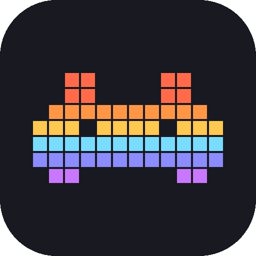

# Ditoo Control

**Turn your Divoom Ditoo Pro into a living status display for your Windows PC.**<br>
Gaming HUD · PC monitor · Claude Code & Codex status · animated weather · pomodoro · ambient effects

[](https://github.com/kantaon/ditoo-control/releases/latest)
[](https://github.com/kantaon/ditoo-control/releases)
[](https://github.com/kantaon/ditoo-control/actions/workflows/ci.yml)
[](#requirements)
[](LICENSE)

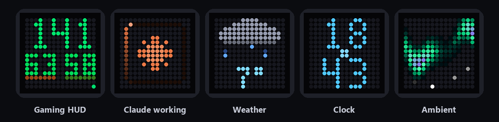

[**⬇ Download for Windows**](https://github.com/kantaon/ditoo-control/releases/latest) &nbsp;·&nbsp; [Features](#features) &nbsp;·&nbsp; [Setup](#setup-in-2-minutes) &nbsp;·&nbsp; [FAQ](#faq) &nbsp;·&nbsp; [Čeština](docs/README.cs.md)

</div>

---

Ditoo Control talks to your Ditoo Pro over Bluetooth and decides **every second** what the 16 × 16 display should show — based on what you are actually doing. Start a game and it becomes a HUD with FPS and temperatures. Send Claude Code a prompt and it shows Claude at work, then a check mark when it's done. Nothing going on? Clock, weather and gentle effects take turns.

No phone app, no cloud, no account. Everything runs locally on your PC.

## Features

<table>
<tr>
<td align="center" width="33%">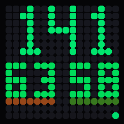<br><b>Gaming HUD</b><br><sub>FPS, CPU | GPU temperature and a 16-second frame-time graph that shows every stutter</sub></td>
<td align="center" width="33%">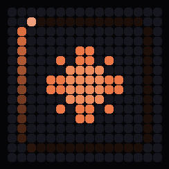<br><b>Claude Code & Codex</b><br><sub>See when an agent works, needs your approval or is done – with its own sign and colour</sub></td>
<td align="center" width="33%">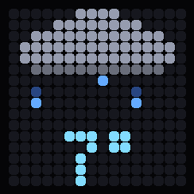<br><b>Animated weather</b><br><sub>Rain, snow, sun, storms and fog, plus tomorrow's forecast in the evening</sub></td>
</tr>
<tr>
<td align="center">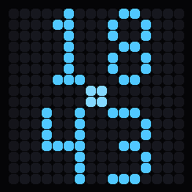<br><b>Clock</b><br><sub>Big digits, blinking colon, seconds filling up the sides</sub></td>
<td align="center">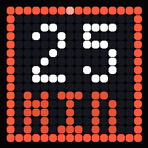<br><b>Pomodoro</b><br><sub>Focus timer with a frame that shrinks as time runs out</sub></td>
<td align="center">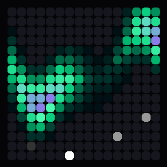<br><b>Ambient effects</b><br><sub>Aurora, fire, plasma, Matrix, warp and Game of Life</sub></td>
</tr>
<tr>
<td align="center">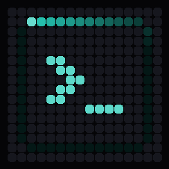<br><b>Codex / ChatGPT</b><br><sub>Teal prompt, ring turns the other way – you always know who's working</sub></td>
<td align="center">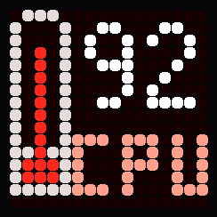<br><b>Overheating alert</b><br><sub>Blinking warning (and a sound) when CPU or GPU gets too hot</sub></td>
<td align="center">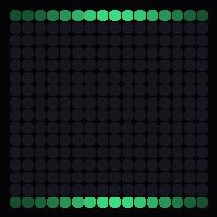<br><b>Notifications</b><br><sub>Any script can put a message on the display – builds, tests, webhooks</sub></td>
</tr>
</table>

**And also:** display off when you're away (saves the Ditoo battery) · your own images and GIFs · scrolling text · lamp / night light · music visualizer · 8-bit notification sounds from the Ditoo speaker · night mode · global hotkeys · English & Czech.

<div align="center">
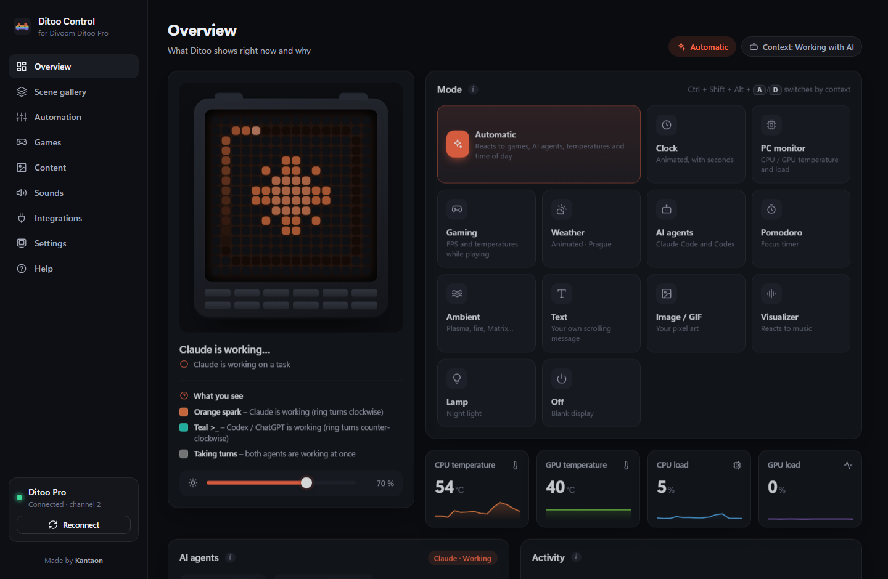
<sub>The app always shows what is on the display, <b>what every pixel means</b> and <b>why</b> it is shown right now.</sub>
</div>

## Setup in 2 minutes

1. **Download** `DitooControl-Setup.exe` from the [latest release](https://github.com/kantaon/ditoo-control/releases/latest) and run it. No admin rights needed.
2. **Pair your Ditoo Pro** with the PC: *Windows Settings → Bluetooth & devices → Add device →* `DitooPro-Audio`.
3. **Start Ditoo Control.** A short setup guide finds your Ditoo, shows a test pattern and checks what your PC can report.

> [!IMPORTANT]
> Ditoo Pro only listens to **the first device that connects**. If it is connected to your phone, turn Bluetooth off on the phone (or close the Divoom app) and switch the Ditoo off and on.

Closing the window keeps the app running in the tray next to the clock. Right-click the tray icon to change mode or quit.

<details>
<summary><b>Prefer Python?</b> Install from source</summary>

```bash
git clone https://github.com/kantaon/ditoo-control
cd ditoo-control
pip install .
ditoo-control            # or: pythonw -m ditoo_control
```

Python 3.11+ on Windows 10/11.
</details>

## Requirements

| | | What it's for | Download |
|---|---|---|---|
| **Divoom Ditoo Pro** | required | the display itself, paired over Bluetooth | – |
| **Windows 10 / 11** | required | built-in Bluetooth stack | – |
| **Microsoft Edge WebView2** | required for the window | built into Windows 11 and most updated Windows 10 PCs; without it the app opens in your browser | [developer.microsoft.com](https://developer.microsoft.com/microsoft-edge/webview2/) |
| **MSI Afterburner** | optional | **CPU temperature** – until then the display shows CPU load instead | [msi.com](https://www.msi.com/Landing/afterburner/graphics-cards) |
| **RivaTuner Statistics Server** | optional | **FPS and frame time** in games, auto-detection of games not on your list | [guru3d.com](https://www.guru3d.com/download/rtss-rivatuner-statistics-server-download/) |

CPU load, GPU load and NVIDIA GPU temperature work out of the box – no extra software. Afterburner and RivaTuner are both free; the app shows their status and download buttons under *Settings → Optional tools*. RivaTuner is also offered as an option during the Afterburner installation.

## How "Automatic" decides

Every second the rules are checked from top to bottom — the first one that applies wins:

1. 🌡️ **Overheating** – CPU or GPU above the critical limit
2. 🔔 **Notification** from a script or webhook
3. ⌨️ **Screen picked with a hotkey** (until the context changes)
4. ✅ **AI finished / failed** – a short confirmation
5. 🎮 **Game running** – gaming HUD (with an intro animation)
6. 🍅 **Pomodoro running**
7. 🤖 **AI working or waiting for you**
8. 🕰️ **Idle** – clock, weather, PC monitor and effects take turns

Every rule can be switched off, durations and limits are adjustable, and you can always pick a fixed mode instead.

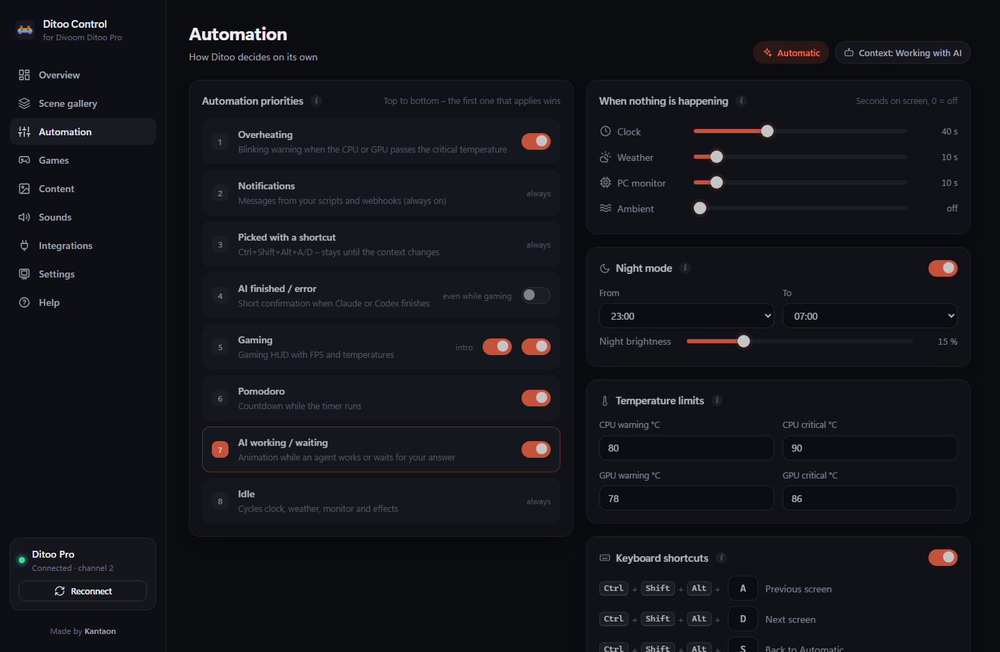

## Claude Code & Codex

One click on the **Integrations** page wires it up:

| Agent | What Ditoo shows | How |
|---|---|---|
| **Claude Code** |  working · 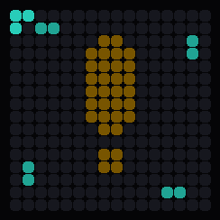 waiting for your approval · 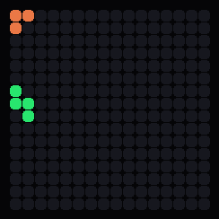 done | hooks in `~/.claude/settings.json` |
| **Codex** | done after every turn | `notify` in `~/.codex/config.toml` |

Every change makes a timestamped backup first and touches only Ditoo Control's own entries. If Codex already has a `notify` command (the Codex app uses one for computer use), it keeps working — Ditoo Control chains it instead of replacing it. Restart Claude Code / Codex after turning an integration on.

## Hotkeys

Work anywhere, even inside games (designed for 60 % keyboards too — no arrows needed):

| Keys | Action |
|---|---|
| <kbd>Ctrl</kbd> + <kbd>Shift</kbd> + <kbd>Alt</kbd> + <kbd>A</kbd> / <kbd>D</kbd> | previous / next screen for what you're doing (gaming · working with AI · idle) |
| <kbd>Ctrl</kbd> + <kbd>Shift</kbd> + <kbd>Alt</kbd> + <kbd>S</kbd> | back to Automatic |
| <kbd>Ctrl</kbd> + <kbd>Shift</kbd> + <kbd>Alt</kbd> + <kbd>W</kbd> | toggle brightness |

Letters are configurable. (Plain <kbd>Ctrl</kbd>+<kbd>Alt</kbd> is AltGr on many European layouts, hence the Shift.)

## Your own scripts

The app listens on `127.0.0.1:7777`:

```bash
# scrolling message with a green frame
curl "http://127.0.0.1:7777/api/notify?text=BUILD%20OK&color=3ddc97"

# your own agent's status: working | done | error | attention | idle
curl "http://127.0.0.1:7777/api/ai?source=agent&state=working"
```

Example — get pinged when a GitHub Actions run finishes:

```bash
gh run watch && curl "http://127.0.0.1:7777/api/notify?text=CI%20PASSED&color=3ddc97"
```

## Light on resources

Built to stay out of the way while you play:

- runs at **below-normal priority** with Windows **EcoQoS** power throttling;
- the hidden window renders **nothing** and polls **nothing**;
- telemetry comes from **shared memory** (Afterburner / RivaTuner) and cheap Windows counters — microseconds per read;
- the gaming HUD is a still image updated in place **at most once a second**, only when values change, with smoothing so numbers don't flicker;
- sounds are muted while gaming.

## Privacy & security

- No telemetry, no accounts, no cloud. The only network request is the weather forecast from [Open-Meteo](https://open-meteo.com) for the city you choose.
- The local API binds to `127.0.0.1` only, rejects foreign `Host` headers and requests coming from other websites, and serves files only from its own folders. See [SECURITY.md](SECURITY.md).

## FAQ

<details><summary><b>The display doesn't react although the app says "connected"</b></summary>

Ditoo Pro accepts commands only from the first device that connects. Turn off Bluetooth on your phone (or close the Divoom app), then switch the Ditoo off and on. The setup guide (*Settings → Run setup again*) walks you through it.
</details>

<details><summary><b>Do I need MSI Afterburner or RivaTuner?</b></summary>

No, both are optional. [MSI Afterburner](https://www.msi.com/Landing/afterburner/graphics-cards) adds the CPU temperature, [RivaTuner Statistics Server](https://www.guru3d.com/download/rtss-rivatuner-statistics-server-download/) adds FPS and frame time. Everything else — clock, weather, AI status, effects, load and NVIDIA GPU temperature, games from your list — works without them.
</details>

<details><summary><b>Does the HUD show input latency or ping?</b></summary>

No. The bottom graph is <b>frame time</b> (how long a frame takes) — the part of input latency you can influence. True click-to-photon latency is only measured by NVIDIA Reflex inside its own overlay, and only the game knows its ping.
</details>

<details><summary><b>My game isn't detected</b></summary>

Add its `.exe` on the **Games** page — or add it with one click from the list of apps RivaTuner currently tracks. Full-screen games are also detected automatically while [RivaTuner](https://www.guru3d.com/download/rtss-rivatuner-statistics-server-download/) is running.
</details>

<details><summary><b>What about the Ditoo battery?</b></summary>

Ditoo doesn't report its battery level over Bluetooth, so the app can't show a percentage. To save it, the display switches completely off (brightness 0) when you're away from the PC or lock it, in Off mode, and at night if you set night brightness to 0. When the battery runs out, the app tells you and reconnects by itself after you charge and switch the Ditoo on. It also works while charging over USB-C.
</details>

<details><summary><b>No sounds</b></summary>

Ditoo must also be connected in Windows as an audio device (`DitooPro-Audio`). Sounds are muted on purpose while gaming and at night (configurable).
</details>

## Development

```bash
pip install -e ".[dev]"
pytest                               # protocol, scenes, integrations, API, translations
ruff check .
python scripts/render_assets.py      # regenerate the GIFs in this README
pyinstaller packaging/DitooControl.spec --noconfirm   # build dist/DitooControl
```

- **Architecture** — `engine.py` decides, `scenes.py` draws (pure functions → 16 × 16 frames), `ditoo.py` speaks the [Divoom protocol](docs/PROTOCOL.md), `server.py` + `ui/` are the desktop UI (WebView2).
- **Translations** — strings are English; add a language by adding a catalogue to `i18n.py` and `ui/i18n.js`. `python scripts/check_i18n.py` lists anything missing.

Contributions are welcome — see [CONTRIBUTING.md](CONTRIBUTING.md).

## Credits

Made by **[Kantaon](https://github.com/kantaon)**.

The Bluetooth protocol is based on the great reverse-engineering work in [andreas-mausch/divoom-ditoo-pro-controller](https://github.com/andreas-mausch/divoom-ditoo-pro-controller), [d03n3rfr1tz3/hass-divoom](https://github.com/d03n3rfr1tz3/hass-divoom) and [RomRider/node-divoom-timebox-evo](https://github.com/RomRider/node-divoom-timebox-evo). Weather by [Open-Meteo](https://open-meteo.com).

Ditoo Control is an independent project and is not affiliated with or endorsed by Divoom, Anthropic, OpenAI or MSI. Product names are trademarks of their owners.

## License

[MIT](LICENSE) © Kantaon
