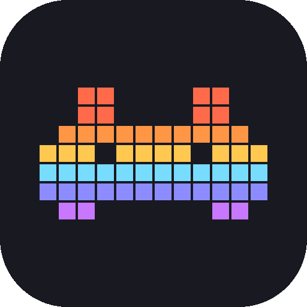
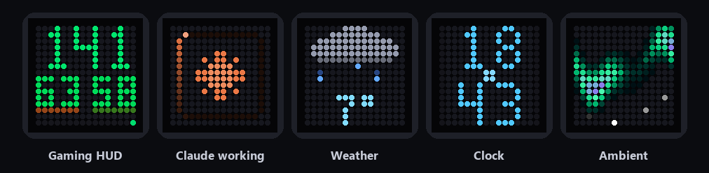
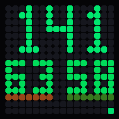
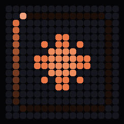
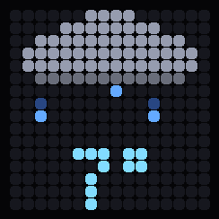
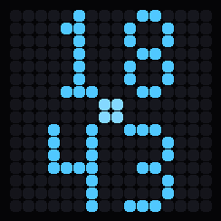
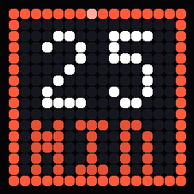
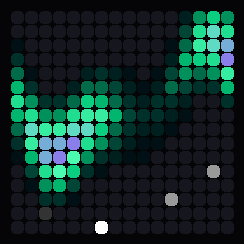

# Ditoo Control

**Udělej z Divoom Ditoo Pro živý stavový displej pro své PC s Windows.** 
Herní HUD · PC monitor · stav Claude Code a Codexu · animované počasí · pomodoro · ambientní efekty

[**⬇ Stáhnout pro Windows**](https://github.com/kantaon/ditoo-control/releases/latest) &nbsp;·&nbsp; [English](../README.md)

---

Ditoo Control komunikuje s Ditoo Pro přes Bluetooth a **každou sekundu** rozhoduje, co má 16 × 16 displej ukazovat – podle toho, co právě děláš. Spustíš hru a z displeje je HUD s FPS a teplotami. Pošleš Claude Code prompt a uvidíš, že pracuje, a pak fajfku, když skončí. Když se nic neděje, střídají se hodiny, počasí a efekty.

Bez aplikace v mobilu, bez cloudu, bez účtu. Všechno běží lokálně na tvém PC.

## Co umí

<table>
<tr>
<td align="center" width="33%"> <b>Herní HUD</b> FPS, teplota CPU | GPU a graf latence snímků za 16 s</td>
<td align="center" width="33%"> <b>Claude Code a Codex</b> Pracuje / čeká na tebe / hotovo – každý agent má svůj znak a barvu</td>
<td align="center" width="33%"> <b>Animované počasí</b> Déšť, sníh, slunce, bouřka, mlha a večer předpověď na zítřek</td>
</tr>
<tr>
<td align="center"> <b>Hodiny</b> Velké číslice, vteřiny se plní po stranách</td>
<td align="center"> <b>Pomodoro</b> Časovač soustředění s ubývajícím rámečkem</td>
<td align="center"> <b>Ambientní efekty</b> Polární záře, oheň, plazma, Matrix, warp, Game of Life</td>
</tr>
</table>

A navíc: zhasnutí displeje, když nejsi u PC (šetří baterii) · vlastní obrázky a GIFy · běžící text · lampa · vizualizér hudby · 8bitové zvuky z reproduktoru Ditoo · noční režim · globální klávesové zkratky · čeština i angličtina.

## Instalace za 2 minuty

1. **Stáhni** `DitooControl-Setup.exe` z [posledního vydání](https://github.com/kantaon/ditoo-control/releases/latest) a spusť ho. Nepotřebuje práva správce.
2. **Spáruj Ditoo Pro** s PC: *Nastavení Windows → Bluetooth a zařízení → Přidat zařízení →* `DitooPro-Audio`.
3. **Spusť Ditoo Control.** Krátký průvodce Ditoo najde, ukáže zkušební obrazec a zkontroluje, co tvoje PC umí hlásit.

> [!IMPORTANT]
> Ditoo Pro poslouchá jen **první zařízení, které se připojí**. Když je připojené k telefonu, vypni na telefonu Bluetooth (nebo zavři aplikaci Divoom) a Ditoo vypni a zapni.

Zavřením okna aplikace dál běží v oznamovací oblasti u hodin.

## Co je potřeba

| | Potřeba | Poznámka |
|---|---|---|
| **Divoom Ditoo Pro** | ✅ | Spárované přes Bluetooth. |
| **Windows 10 / 11** | ✅ | |
| **MSI Afterburner + RivaTuner** | volitelné | Jen pro **teplotu CPU** a **FPS**. Vytížení CPU/GPU a teplota GPU u karet NVIDIA fungují i bez něj – displej pak místo teploty CPU ukazuje vytížení. |

## Jak se rozhoduje „Automaticky“

1. 🌡️ Přehřívání CPU nebo GPU
2. 🔔 Oznámení ze skriptu nebo webhooku
3. ⌨️ Obrazovka vybraná zkratkou
4. ✅ AI dokončilo / chyba
5. 🎮 Běží hra – herní HUD
6. 🍅 Běží pomodoro
7. 🤖 AI pracuje nebo čeká na tebe
8. 🕰️ Klid – hodiny, počasí, monitor a efekty

## Klávesové zkratky

| Klávesy | Akce |
|---|---|
| <kbd>Ctrl</kbd> + <kbd>Shift</kbd> + <kbd>Alt</kbd> + <kbd>A</kbd> / <kbd>D</kbd> | předchozí / další obrazovka podle kontextu |
| <kbd>Ctrl</kbd> + <kbd>Shift</kbd> + <kbd>Alt</kbd> + <kbd>S</kbd> | zpět na Automatiku |
| <kbd>Ctrl</kbd> + <kbd>Shift</kbd> + <kbd>Alt</kbd> + <kbd>W</kbd> | přepnout jas |

Fungují i ve hrách a na 60% klávesnici (bez šipek).

## Šetrné k výkonu

Nižší priorita procesu a úsporný režim Windows (EcoQoS), skryté okno nic nevykresluje, senzory se čtou ze sdílené paměti, herní HUD se aktualizuje nejvýš jednou za sekundu a jen při změně hodnot.

## Soukromí

Žádná telemetrie, účty ani cloud. Jediný požadavek do internetu je předpověď počasí z [Open-Meteo](https://open-meteo.com) pro zvolené město.

---

Vytvořil **[Kantaon](https://github.com/kantaon)** · [MIT licence](../LICENSE) · Projekt není spojený se společnostmi Divoom, Anthropic, OpenAI ani MSI.
